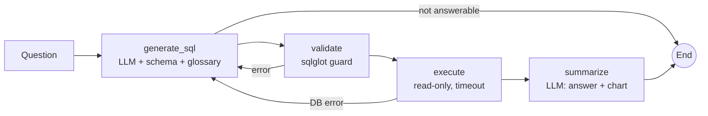

# Ask Your Data

Ask business questions in plain English — *"Which region's revenue dropped last quarter?"* — and get
back a direct answer, the SQL that produced it, a results table and a chart.

A LangGraph agent writes the SQL with an LLM, a guard checks it, the database runs it read-only,
and if anything fails the error goes back to the model to fix (up to 3 attempts). A fixed KPI
dashboard sits alongside the free-form questions. The AI provider is a config setting: Gemini by
default, Claude or OpenAI with a one-line change.

<!-- Add a screenshot or GIF of the app here:  -->

## How it works



| Layer | What it does |
|---|---|
| **Semantic layer** (`app/db/catalog.py`) | Data dictionary + business glossary sent with every question, so "revenue" always excludes cancelled/returned orders. |
| **Agent** (`app/agent/`) | LangGraph state machine: generate → validate → execute → summarize, with self-correction on validation or database errors. |
| **LLM layer** (`app/llm/`) | Provider-agnostic: one `complete_json()` contract, adapters for Gemini, Claude and OpenAI, all using structured JSON-schema output. Prompts are written once and shared by every provider. Token usage is tracked per step. |
| **SQL guard** (`app/sql/guard.py`) | Parses with sqlglot: single statement, SELECT only, allow-listed tables, no system catalogs, no `pg_sleep`/file functions, no `FOR UPDATE`, enforced `LIMIT`. |
| **Execution** (`app/db/executor.py`) | Read-only transaction, statement timeout, row cap; on Postgres a dedicated `app_readonly` role. Three independent layers of protection. |
| **API** (`app/api/`) | FastAPI with one router per feature: `/api/ask`, `/api/kpis`, `/api/schema`, `/api/health`; typed request/response models; optional API key and per-IP rate limit on the paid endpoint; JSON request logs with token counts. |
| **UI** (`app/web/static/`) | KPI tiles, trend charts, ask box, answer + table + chart + SQL + agent trace. INR formatting in lakh/crore. |
| **Evaluation** (`evals/`) | 31 questions with hand-written reference SQL; execution-accuracy scoring; works with any provider, so models can be compared on the same set. |

The demo data is a synthetic Indian e-commerce store (2,500 customers, ~16K orders, 2024–2025) with
patterns planted on purpose: a Diwali-season spike, East-region slump in Q4 2025, higher COD
cancellations and Fashion returns.

## Choosing the AI provider

Set these in `.env` — no code changes:

| Provider | `LLM_PROVIDER` | Key | Default models (SQL / summary) |
|---|---|---|---|
| Google Gemini | `gemini` | `GEMINI_API_KEY` from aistudio.google.com/apikey | `gemini-3.8-flash` / `gemini-3.5-flash-lite` |
| Anthropic Claude | `anthropic` | `ANTHROPIC_API_KEY` from console.anthropic.com | `claude-opus-5-5` / `claude-opus-5-5` |
| OpenAI | `openai` | `OPENAI_API_KEY` from platform.openai.com | none — set `LLM_SQL_MODEL` and `LLM_SUMMARY_MODEL` |

Override either model with `LLM_SQL_MODEL` / `LLM_SUMMARY_MODEL`, and reasoning depth with
`LLM_SQL_REASONING` / `LLM_SUMMARY_REASONING` (`low | medium | high`, mapped to Gemini thinking level,
Claude effort or OpenAI reasoning effort). SQL writing gets the stronger model; the summary step uses
a cheaper one.

**Adding another provider:** write a class with `name` and `complete_json()` in `app/llm/providers/`,
register it in `app/llm/providers/__init__.py`, and add default models in `app/llm/factory.py`.

## Run it locally (Windows / macOS / Linux)

Needs Python 3.11+ and an API key for your chosen provider.

```bash
python -m venv .venv
.venv\Scripts\activate          # macOS/Linux: source .venv/bin/activate
pip install -r requirements-dev.txt
copy .env.example .env          # macOS/Linux: cp .env.example .env  — then paste your key into .env
uvicorn app.main:app --reload
```

Open http://localhost:8000. The SQLite demo database is created and seeded on first start.
The dashboard works without a key; asking questions needs one.

## Run with PostgreSQL (Docker)

```bash
docker compose up --build
```

Starts Postgres 16, creates a read-only role, seeds the data and serves the app on port 8000.

## Tests

```bash
pytest -q
```

104 tests, no API key needed (models and SDK clients are replaced by stubs), split into
`tests/unit` (SQL guard, LLM adapters and provider switching, chart choice, eval scoring) and
`tests/integration` (read-only execution, timeouts, KPIs, agent retry paths, HTTP API auth and rate
limiting, eval reference SQL). CI (GitHub Actions) lints with ruff and runs the suite against both
SQLite and PostgreSQL.

```bash
ruff check .        # lint
ruff format .       # format (VS Code does this on save)
```

## Working in VS Code

Open the folder (`code "D:\Ask Your Data"`) and accept the recommended extensions. The workspace
settings select `.venv` automatically, format and lint with Ruff on save, and discover the tests.
Run configurations (Run and Debug panel): **API server**, **Seed demo data**, **Run eval**,
**Debug current test file**.

## Evaluation

```bash
python -m evals.run_eval            # calls the real model: costs a little per run
```

Each question's reference SQL and the agent's SQL are both executed; a question passes when the
result values match (order-insensitive, extra columns allowed, numeric tolerance). Two questions are
deliberately unanswerable and pass only if the agent declines. Results, including average tokens per
question, go to `evals/results.json`. Change `LLM_PROVIDER` / models and re-run to compare.

| Provider | SQL model | Execution accuracy | Self-corrected | Median latency | Avg tokens in / out |
|---|---|---|---|---|---|
| gemini | gemini-3.8-flash | _run the eval and fill in_ | | | |

## Project layout

Each package owns one concern and each module one responsibility. Every file starts with a
docstring saying what it does and how to use it. Dependencies point one way:
`api → agent → llm / sql / db → core`.

```
app/
  main.py                 ASGI entry point (uvicorn app.main:app)
  core/                   cross-cutting, no business logic
    config.py             settings from env / .env
    logging.py            JSON-lines logging
  db/                     data access
    models.py             table definitions
    catalog.py            data dictionary, business glossary, schema text for the model
    engine.py             owner + read-only engines
    executor.py           read-only execution with timeout and row cap
    seed.py               demo data (python -m app.db.seed)
  sql/
    guard.py              static SQL validation
  llm/                    provider-agnostic AI layer
    contracts.py          the provider interface (complete_json)
    errors.py             provider-neutral errors
    prompts.py            prompts + JSON schemas (shared by all providers)
    text_to_sql.py        generate_sql() and summarize()
    factory.py            builds the configured provider
    providers/            gemini.py, anthropic.py, openai.py
  agent/                  LangGraph workflow
    state.py              state passed between nodes
    graph.py              nodes, routing, ask()
    charts.py             chart suggestion check
  analytics/
    kpis.py               dashboard KPI queries
  api/                    HTTP layer
    factory.py            create_app(): wiring, lifespan, routers, static files
    container.py          long-lived services (engines, limiter, agent)
    dependencies.py       services lookup, API key + rate limit
    rate_limit.py         sliding-window limiter
    schemas.py            request/response models
    routes/               health.py, dashboard.py, ask.py
  web/static/             dashboard UI (HTML/CSS/JS)
evals/                    dataset.py, scoring.py, run_eval.py, questions.jsonl
tests/                    fakes.py, conftest.py, unit/, integration/
docker/                   Postgres read-only role
.vscode/                  shared editor settings, run configs, recommended extensions
```
