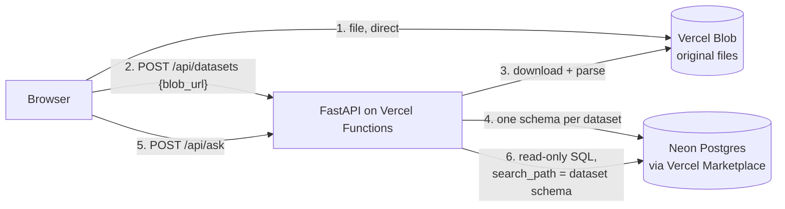

# Deploying to Vercel with a cloud database

Locally, every upload becomes a SQLite file in `data/uploads/`. That cannot work on Vercel:
function instances have no persistent disk, so files written by one request are gone for the
next. This document is the plan for storing and querying data in the cloud.

Limits that shape the design (Vercel Functions docs, checked November 2026):

| Limit | Value | Consequence |
|---|---|---|
| Request body | 4.5 MB | Larger uploads cannot be POSTed to the API; upload them to Blob storage first |
| Persistent disk | none | Tables and metadata must live in a database |
| Python bundle | 500 MB uncompressed | pandas + pyarrow + parsers fit, but watch the size |
| Max duration | Hobby 300 s, Pro up to 800 s | Large files must be parsed within this window |

## Recommended architecture

1. **Original files: Vercel Blob (private store).** The browser uploads directly to Blob using a
   short-lived client token issued by our API, which bypasses the 4.5 MB body limit. Keeping the
   original lets you re-process files when the parser improves.
2. **Tables: Postgres (Neon from the Vercel Marketplace, or Supabase).** One schema per dataset,
   e.g. `ds_3f9a1c2b7d10`, created by the owner role. The demo store lives in its own `demo` schema.
3. **Metadata: a `datasets` table** in Postgres, replacing the JSON files:
   `id, owner_id, name, filename, file_format, size_bytes, created_at, blob_url, profile jsonb`.
4. **Querying safely.** Generated SQL runs as the read-only role (already supported through
   `READONLY_DATABASE_URL`) with `SET LOCAL search_path TO ds_<id>` inside the read-only transaction.
   The SQL guard already rejects schema-qualified names, so a query can only reach the current
   dataset's tables, never another user's.
5. **Connections.** Use Neon's *pooled* connection string and SQLAlchemy's `NullPool` in
   serverless functions, so short-lived instances don't exhaust database connections.

## Code changes needed (scoped; the local design was built for this)

| Area | Change |
|---|---|
| `app/datasets/store.py` | Add `PostgresDatasetStore` with the same methods as `LocalDatasetStore` (`save`, `get`, `list`, `delete`, `readonly_engine`); pick it from config (`DATASETS_BACKEND=postgres`). `save` uses `DataFrame.to_sql(schema=...)`. |
| `app/db/executor.py` | Accept an optional schema and issue `SET LOCAL search_path` after `SET TRANSACTION READ ONLY`. |
| `app/api/routes/datasets.py` | Add `POST /api/datasets/upload-token` (issues Blob client tokens) and accept `{blob_url}` as an alternative to multipart. |
| `app/web/static/js/upload.js` | For files over 4 MB: get a token, upload to Blob, then call the API with the URL. |
| Auth | Uploads become per-user once sign-in exists (e.g. Clerk or Auth.js): store `owner_id` and filter every dataset query by it. Blob tokens must only be issued to signed-in users. |
| Retention | A scheduled job (Vercel Cron) that drops schemas and blobs for datasets older than N days. |

## Alternative: one container instead of serverless

If uploads are large or parsing is slow, run the existing Docker image on a container host
(Vercel's Docker support, Render, Railway, Fly.io or Google Cloud Run) with a persistent volume or
the same Postgres + Blob setup. This keeps the code almost unchanged and removes the request-size
and duration limits; the trade-off is paying for an always-on container.

## Rough cost at portfolio scale

Neon and Vercel Blob both have free tiers that cover a demo with a handful of datasets. The main
running cost is the AI provider (about ₹0.7 per question with the default Gemini models).
