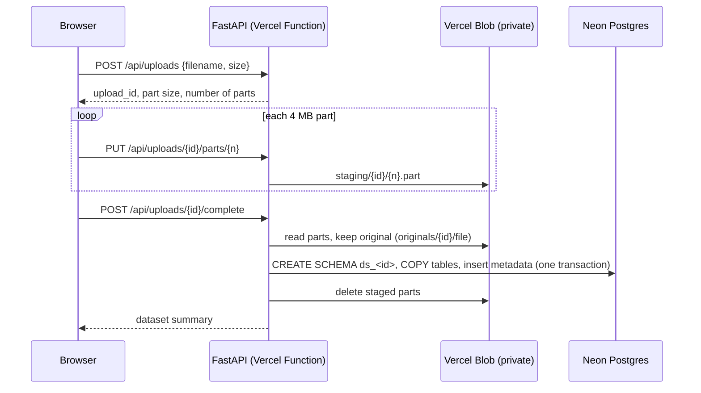

# Deploying to Vercel (Neon Postgres + Vercel Blob)

Locally, every upload becomes a SQLite file in `data/uploads/`. That can't work on Vercel:
function instances have no persistent disk, so files written by one request are gone for the
next. In the cloud the app switches storage automatically:

| | Local (default) | Vercel |
|---|---|---|
| Demo store | SQLite file `data/shop.db` | Postgres `public` schema, seeded on first start |
| Uploaded tables | one SQLite file per dataset | Postgres, one schema per dataset (`ds_<id>`) |
| Dataset metadata | JSON file per dataset | `datasets` table (profile as `jsonb`) |
| Upload parts, original files | local temp folder (originals not kept) | private Vercel Blob store |

The switch is configuration only: `DATABASE_URL` pointing at Postgres selects the Postgres store,
and `BLOB_READ_WRITE_TOKEN` (set by Vercel when a Blob store is connected) selects Blob.

Limits that shaped the design (Vercel docs, November 2026):

| Limit | Value | Consequence |
|---|---|---|
| Request body | 4.5 MB | The browser sends files in 4 MB parts |
| Persistent disk | none | Tables and metadata live in Postgres |
| Python bundle | 500 MB uncompressed | Tests, docs and data are excluded (`vercel.json`, `.vercelignore`) |
| Max duration | Hobby 300 s | Set in `vercel.json`; covers parsing a 50 MB file |

## How an upload works in the cloud

Questions about an upload run with `SET LOCAL search_path TO ds_<id>` inside a read-only
transaction, and the SQL guard rejects schema-qualified names, so generated SQL can only see that
dataset's tables. Seeding the demo store runs in one transaction holding a Postgres advisory lock,
so instances that cold-start at the same time don't load the data twice.

## Setting it up

1. **Import the GitHub repo** as a Vercel project (framework preset: FastAPI; entrypoint
   `app/main.py` is detected automatically, dependencies come from `requirements.txt`).
2. **Storage → Create → Blob**, access **Private**, connect it to the project (adds
   `BLOB_READ_WRITE_TOKEN`).
3. **Storage → Create → Neon (Postgres)** from the Marketplace and connect it to the project (adds
   `DATABASE_URL`, the pooled connection string the app uses).
4. **Settings → Environment Variables:** add `GEMINI_API_KEY` (or another provider's key and
   `LLM_PROVIDER`).
5. Redeploy. The first request after a deploy seeds the demo store (takes a few seconds once).

`GET /api/health` shows what is in use, e.g. `"storage": {"datasets": "postgres", "files": "vercel-blob"}`.

## Before sharing the link publicly

- Anyone with the URL can upload files and spend your AI quota. The per-IP rate limit
  (`RATE_LIMIT_PER_MINUTE`) is kept per function instance, so treat it as a speed bump. Set a
  spending limit on the AI provider's side, or protect the deployment (Vercel Deployment
  Protection, or `APP_API_KEY` for API clients).
- Uploads are private: uploading needs an account and each dataset is visible only to its owner.
  Set `ADMIN_EMAILS` (your sign-in email) in the Vercel environment variables to review answers
  rated "not helpful" on the Metrics page.
- Neon gives one database owner role. Model SQL is still limited by the SQL guard and the
  read-only transaction; for a third layer, create a read-only role in Neon and set
  `READONLY_DATABASE_URL` (new dataset schemas are granted to it automatically).
- Retention: a scheduled job (Vercel Cron) could drop schemas and blobs older than N days.

## Rough cost at portfolio scale

Neon and Vercel Blob free tiers cover a demo with a handful of datasets. The main running cost is
the AI provider (about ₹0.7 per question with the default Gemini models).
